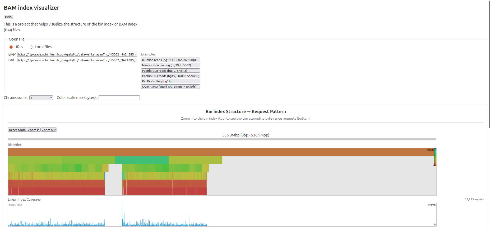
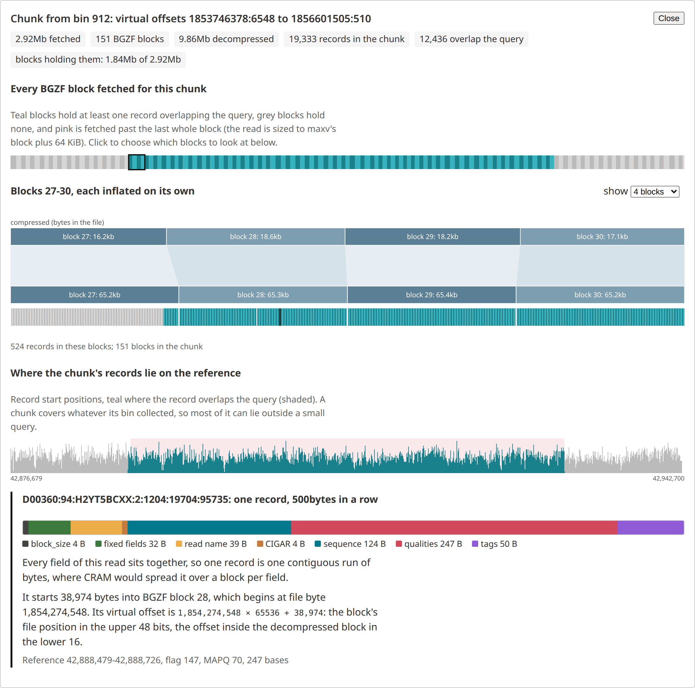

# bam_index_visualizer

I wanted to see the way that data is requested from BAM files by inspecting
visually what request pattern is generated from querying a BAI file

## Screenshot

## Chunk inspector

Click Inspect on any chunk in the requested block overview to fetch and inflate
it in the browser, and see:

- every BGZF block the chunk's read covers, marking the ones that hold a record
  overlapping the query
- a few blocks in detail, compressed against decompressed, with the BAM records
  laid end to end across them and the chunk's minv and maxv virtual offsets
- where the chunk's records fall on the reference, against the query
- one record's bytes field by field, and how its virtual offset points at it

## Demo

https://cmdcolin.github.io/bam_index_visualizer
